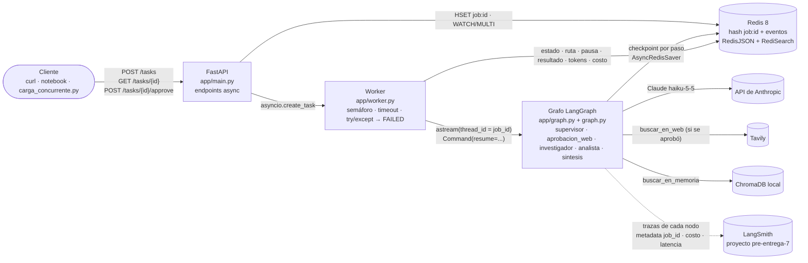
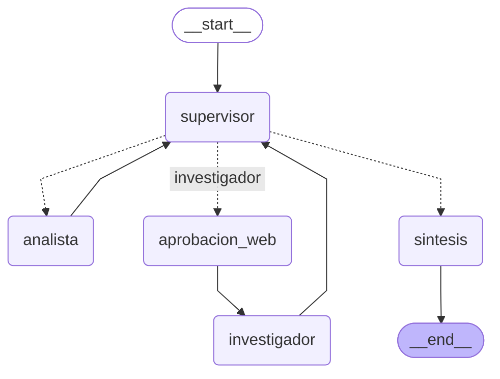
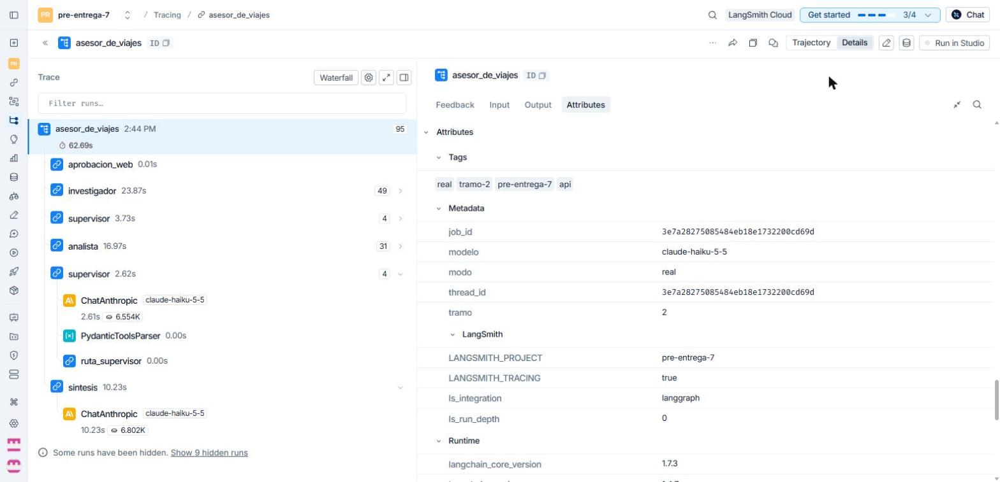
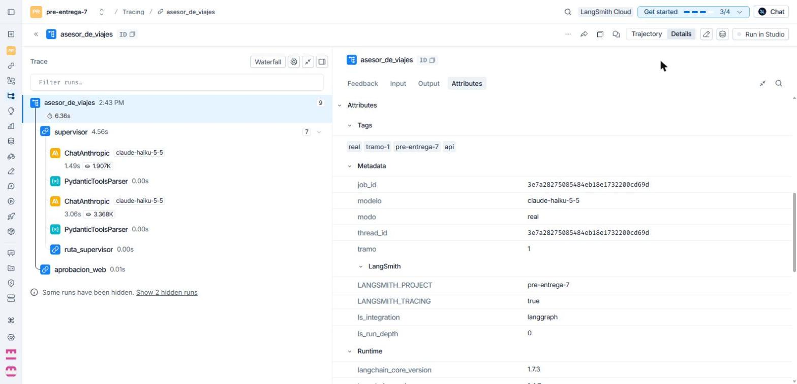
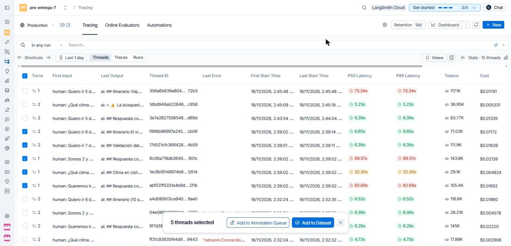
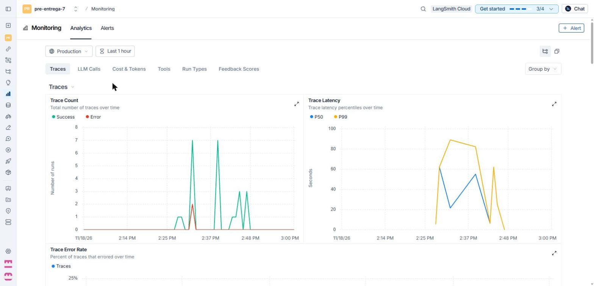

# Asesor de viajes multi-agente · Pre-entrega 7 — API de producción y monitoreo activo

> Curso AI Engineering · Coderhouse. Continuación de la [Pre-entrega 6](https://github.com/anukvilarasau/pre-entrega-6): el orquestador **jerárquico** de LangGraph (supervisor + investigador + analista + síntesis) ahora corre detrás de una **API FastAPI asíncrona**, con el estado de cada job en **Redis**, checkpoints de LangGraph con **`AsyncRedisSaver`**, un nodo **human-in-the-loop** que pide permiso antes de gastar búsquedas web, y **trazas, costo y latencia en LangSmith**.

```text
POST /tasks  ──►  202 {job_id}  (al instante)        GET /tasks/{id}  ──►  PENDING → RUNNING → WAITING_APPROVAL → RUNNING → DONE | FAILED
                                                     POST /tasks/{id}/approve {"aprobado": true|false}  ──►  el grafo sigue desde su checkpoint
```

Pregunta de demo: *"Quiero ir 7 días a Bariloche en enero, somos 2 personas, salimos desde Mendoza y tenemos 800.000 pesos. ¿Me armás el viaje y me decís si nos alcanza?"*

---

## Índice

1. [Rúbrica → dónde se cumple](#1-rúbrica--dónde-se-cumple)
2. [Arquitectura](#2-arquitectura)
3. [El grafo de producción (Mermaid generado desde el código)](#3-el-grafo-de-producción)
4. [La API: endpoints y ejemplos con curl](#4-la-api-endpoints-y-ejemplos-con-curl)
5. [Worker y estado en Redis](#5-worker-y-estado-en-redis)
6. [Human-in-the-loop: aprobar la búsqueda web](#6-human-in-the-loop-aprobar-la-búsqueda-web)
7. [Observabilidad con LangSmith y capturas](#7-observabilidad-con-langsmith-y-capturas)
8. [Prueba de carga: 5 pedidos concurrentes y lectura del dashboard](#8-prueba-de-carga-5-pedidos-concurrentes-y-lectura-del-dashboard)
9. [Instalación paso a paso (Docker y sin Docker)](#9-instalación-paso-a-paso)
10. [Tests](#10-tests)
11. [Cambios respecto de la PE6](#11-cambios-respecto-de-la-pe6)
12. [Lo que aprendimos de las corridas reales](#12-lo-que-aprendimos-de-las-corridas-reales)
13. [Estructura del repositorio](#13-estructura-del-repositorio)
14. [Limitaciones](#14-limitaciones)
- [Anexo A — El orquestador (de la PE6): topología, agentes, estado, supervisor](#anexo-a--el-orquestador-de-la-pe6)

---

## 1. Rúbrica → dónde se cumple

| Requisito (peso) | Cómo se cumple | Dónde |
|---|---|---|
| **API FastAPI asíncrona (30 %)**: `POST /tasks` encola y devuelve `job_id` sin bloquear; `GET /tasks/{id}` devuelve estado y resultado | `POST /tasks` guarda el job en Redis (`redis.asyncio`, una sola ida y vuelta) y crea una tarea de asyncio: responde **202 en milisegundos** (medido: 2 ms en mock, 166 ms contra Redis Cloud). Ningún endpoint espera al grafo ni hace I/O sync; lo sync al arrancar (ChromaDB, modelos) va por `run_in_threadpool`, y ChromaDB dentro del grafo por `asyncio.to_thread`. | [`app/main.py`](app/main.py) · tests `test_post_devuelve_job_id_al_instante_sin_esperar_al_grafo` (POST con un grafo que tarda 1 s: responde en < 0,3 s y `/health` sigue respondiendo) |
| **Estado en Redis + checkpoints (25 %)**: PENDING → RUNNING → WAITING_APPROVAL → DONE / FAILED, `RedisSaver` async, toda excepción → FAILED | Un hash `job:<id>` con pregunta, estado, timestamps, ruta, pausa, resultado, error, tokens, costo y `thread_id` (= `job_id`). Checkpoints con **`AsyncRedisSaver`** (Redis 8). El worker envuelve todo en `try/except`: excepción del grafo, timeout y apagado → **FAILED con el error**. | [`app/worker.py`](app/worker.py), [`app/graph.py`](app/graph.py) · tests `test_una_excepcion_del_grafo_pasa_el_job_a_failed`, `test_timeout_pasa_a_failed`, `test_apagar_la_api_…`, `test_el_estado_del_job_vive_en_un_hash_de_redis`, `test_un_worker_nuevo_reanuda_el_job_pausado_por_otro`, `test_pausa_y_reanudacion_con_async_redis_saver_real` |
| **Observabilidad con LangSmith (25 %)**: trazas de cada nodo + 5 peticiones concurrentes con costo por ejecución y latencia p95 en `/screenshots` | Tracing de LangChain/LangGraph con metadata `job_id`/`thread_id`/`tramo` y tags. Cada nodo es un run con nombre propio. LangSmith calcula el costo de `claude-haiku-5-5` (verificado: coincide al centavo con el costo local). Prueba de carga: 5/5 DONE, **p95 = 91,0 s**, US$ 0,0708 en total. | [`app/observability.py`](app/observability.py), [`scripts/carga_concurrente.py`](scripts/carga_concurrente.py), [`screenshots/`](screenshots/) ([`resultados_carga.md`](screenshots/resultados_carga.md)), §7 y §8 |
| **Human-in-the-loop (15 %)**: el grafo se pausa hasta la aprobación externa (`POST /tasks/{id}/approve`) | Nodo `aprobacion_web` antes de que el investigador vaya a la web. Si la memoria responde, no hay pausa. Usa `interrupt()` y se reanuda con `Command(resume=...)`. `aprobado=false` sigue sin web y la síntesis lo aclara. `auto_aprobar` por request. | [`app/hitl.py`](app/hitl.py) · [`tests/test_hitl.py`](tests/test_hitl.py) (pausa, aprobado, rechazado, memoria, auto) |
| **README + requirements (5 %)** | Este README (Redis + API con y sin Docker, curl, carga) y `requirements.txt` con versiones fijas. | §9, [`requirements.txt`](requirements.txt), [`docker-compose.yml`](docker-compose.yml) |

**Mejoras que pidió el corrector en la PE6:**

1. *Publicar DAGs/trazas de ejecución de `consultar()` como evidencia visual* → capturas de LangSmith en [`screenshots/`](screenshots/) (traza completa, pausa HITL, costo, latencia) + Mermaid **regenerado desde el código** con el nodo HITL (`python main.py --mermaid`, §3).
2. *Backend/API que exponga `consultar()` y mostrar el orquestador interactuando en vivo desde el notebook* → esta API + [`demo.ipynb`](demo.ipynb) **ejecutado contra la API real**: hace `POST /tasks`, polling, la pausa HITL, `approve` aprobado y rechazado, el caso "la memoria responde" y la tabla de la carga, con las salidas guardadas.

**Lo que se mantuvo de la PE6** (fortalezas marcadas): Mermaid generado desde el código; supervisor con `Literal`, rúbrica R1–R6 y frenos anti-bucle; herramientas reales por rol, con fuentes tomadas de los artifacts y no del LLM, inyectables, y errores devueltos como texto al LLM; `validar_actualizacion()` (ahora también para el nodo HITL); **los 128 tests de la PE6 siguen pasando**; la justificación de la topología ([Anexo A.2](#a2-por-qué-una-topología-jerárquica)).

---

## 2. Arquitectura



**Recorrido de un job:**

1. `POST /tasks` valida el cuerpo (Pydantic), crea el hash `job:<id>` en **PENDING** y llama a `worker.iniciar()`, que hace `asyncio.create_task(...)`, guarda la referencia y vuelve. Respuesta **202** con `job_id` y links.
2. El worker toma un lugar del semáforo (`MAX_JOBS_CONCURRENTES=5`), pasa el job a **RUNNING** y corre `grafo.astream(estado_inicial, config)` con `thread_id = job_id`. Cada nodo que termina deja un evento en `job:<id>:eventos` y actualiza `nodo_actual` y `ruta`: `GET` muestra el progreso.
3. Si el supervisor manda al investigador y la memoria no tiene los temas, el nodo `aprobacion_web` llama a `interrupt()`. El grafo se detiene, el checkpoint queda en Redis y el job pasa a **WAITING_APPROVAL** con `aprobacion_pendiente` (qué quiere buscar).
4. `POST /approve` hace la transición WAITING_APPROVAL → RUNNING de forma **atómica** (WATCH/MULTI: un segundo approve recibe 409) y relanza el worker con `Command(resume={"aprobado": ...})`. LangGraph retoma desde el checkpoint, aunque la API se haya reiniciado en el medio.
5. Al terminar: **DONE** con `resultado` (respuesta final, ruta, métricas, permisos, aprobaciones), tokens, costo y duraciones. Cualquier excepción: **FAILED** con `error`.

**Decisiones de diseño:**

| Decisión | Por qué |
|---|---|
| Worker = tareas de asyncio (sin Celery/Arq) | El grafo ya es async de punta a punta (`ainvoke`, `astream`, herramientas corrutina): no hace falta otro proceso ni otra cola. Las referencias quedan en un `set` hasta que la tarea termina (si no, el GC puede cortarla). El límite de concurrencia es un `asyncio.Semaphore`. |
| Redis para el estado **y** para los checkpoints | Un solo servicio. El hash del job es lo que lee el cliente; los checkpoints son lo que necesita LangGraph para pausar y reanudar. Los dos sobreviven a un reinicio de la API. |
| `thread_id = job_id` | Un hilo de LangGraph por job: reanudar es pasar el mismo `thread_id`, y LangSmith agrupa los dos tramos del job (antes y después de la pausa) en la vista *Threads*. |
| Pool de conexiones **bloqueante** con tope | Redis Cloud gratis admite 30 clientes. Sin tope, la primera carga real dio `max number of clients reached` (§12). Con `BlockingConnectionPool`, un job espera una conexión libre en lugar de fallar. |
| Modo mock con fakeredis + `InMemorySaver` | La API completa corre **sin claves y sin Redis** (LLM con guion + Tavily falso de la PE6). fakeredis no implementa RediSearch (`FT.*`), que necesita `RedisSaver`; por eso en mock el checkpointer es `InMemorySaver` (misma interfaz). Con `REDIS_URL` se usa Redis real y `AsyncRedisSaver`, también en mock. |
| Recuperación al arrancar | Si la API se cae (kill -9) con jobs RUNNING, al arrancar se reanudan desde su último checkpoint. Sin checkpoints persistentes pasan a FAILED con el motivo. Los WAITING_APPROVAL siguen esperando su approve. |

---

## 3. El grafo de producción

Generado por LangGraph desde el código con `python main.py --mock --mermaid` (el mismo grafo de la PE6 + el nodo HITL; `--sin-hitl` imprime el de la consola, idéntico al de la PE6):



La única diferencia con la PE6 está en `graph.construir_grafo(componentes, nodo_aprobacion=..., checkpointer=...)`. Si se le pasa el nodo HITL, la arista condicional `"investigador"` del supervisor apunta a `aprobacion_web`, y `aprobacion_web → investigador`. Sin esos argumentos (consola, escenarios y tests de la PE6), el grafo es exactamente el de antes. `app/graph.py` arma la versión de producción:

```python
def construir_grafo_api(componentes, checkpointer, max_pasos=None):
    return construir_grafo(componentes, max_pasos=max_pasos,
                           nodo_aprobacion=crear_nodo_aprobacion(componentes.memoria),
                           checkpointer=checkpointer)          # AsyncRedisSaver o InMemorySaver
```

---

## 4. La API: endpoints y ejemplos con curl

| Método y ruta | Qué hace | Respuestas |
|---|---|---|
| `POST /tasks` | Encola una pregunta: `{"pregunta": "...", "auto_aprobar": false}` | **202** `{job_id, estado: PENDING, links}` · 422 si el cuerpo es inválido |
| `GET /tasks/{job_id}` | Estado, progreso (`nodo_actual`, `ruta`), pausa (`aprobacion_pendiente`), `resultado`, `error`, tokens, costo, duraciones | 200 · 404 |
| `POST /tasks/{job_id}/approve` | Responde la pausa: `{"aprobado": true, "comentario": "opcional"}` | **202** `{estado: RUNNING}` · 404 · **409** si no está esperando aprobación |
| `GET /tasks?limite=20` | Los últimos jobs | 200 |
| `GET /health` | Redis (ping), tipo de checkpointer, modo, modelo, LangSmith, jobs activos | 200 |
| `GET /docs` | Swagger generado por FastAPI | |

Ejemplos (bash; en Windows conviene mandar el cuerpo desde un archivo UTF-8, como [`scripts/ejemplo_task.json`](scripts/ejemplo_task.json), para que no se rompan las tildes):

```bash
curl -s localhost:8000/health

# 1. Encolar (vuelve enseguida con el job_id)
curl -s -X POST localhost:8000/tasks -H "Content-Type: application/json" --data-binary @scripts/ejemplo_task.json
# {"job_id":"a4be1ccdf4694ac9861baa8a9731eeee","estado":"PENDING","links":{"estado":"/tasks/a4be…","aprobar":"/tasks/a4be…/approve"}}

# 2. Consultar el estado (polling)
curl -s localhost:8000/tasks/a4be1ccdf4694ac9861baa8a9731eeee
# {"estado":"WAITING_APPROVAL","nodo_actual":"aprobacion_web","ruta":["supervisor"],
#  "aprobacion_pendiente":{"tipo":"aprobacion_busqueda_web","destino":"Bariloche",
#     "temas_sin_memoria":["pasajes","alojamiento","comida","actividades","cambio"],"temas_en_memoria":[],
#     "consultas_previstas":["precio de pasajes Mendoza → Bariloche","precio de alojamiento por noche en Bariloche", …],
#     "instruccion_del_supervisor":"Buscar datos actuales con fuente … para un viaje de Mendoza a Bariloche …"}, …}

# 3. Aprobar (o rechazar con {"aprobado": false})
curl -s -X POST localhost:8000/tasks/a4be1ccdf4694ac9861baa8a9731eeee/approve \
     -H "Content-Type: application/json" -d '{"aprobado": true, "comentario": "ok"}'
# {"job_id":"a4be…","estado":"RUNNING","aprobado":true}

# 4. Polling hasta DONE
curl -s localhost:8000/tasks/a4be1ccdf4694ac9861baa8a9731eeee
# {"estado":"DONE","tramos":2,"duracion_s":86.92,"tiempo_ejecucion_s":68.34,"total_tokens":87518,"costo_usd":0.013759,
#  "resultado":{"ruta":"supervisor → aprobacion_web → investigador → supervisor → analista → supervisor → sintesis",
#               "permiso_web":"aprobada","respuesta_final":"## Presupuesto: no alcanza …","metricas":{…}}, …}
```

PowerShell: `Invoke-RestMethod -Method Post localhost:8000/tasks -ContentType "application/json; charset=utf-8" -InFile scripts\ejemplo_task.json`.

Los números de arriba son de la corrida real del 18/11/2026 (job `a4be1ccd`). La traza completa está en [`traces/api/api_a4be1ccd_real_20261118-142852.log`](traces/api/).

---

## 5. Worker y estado en Redis

**El hash `job:<job_id>`** (más `job:<job_id>:eventos`, una lista con lo que hizo cada nodo, y el sorted set `jobs` por fecha):

| Campo | Contenido |
|---|---|
| `id`, `thread_id` | El `job_id` (uuid4 hex); `thread_id` es el mismo: el hilo del checkpoint de LangGraph |
| `pregunta`, `auto_aprobar`, `modo` | Lo que mandó el cliente y si la API está en mock o real |
| `estado` | `PENDING` · `RUNNING` · `WAITING_APPROVAL` · `DONE` · `FAILED` |
| `creado`, `iniciado`, `actualizado`, `terminado` | Timestamps ISO con milisegundos y zona horaria |
| `nodo_actual`, `ruta`, `tramos` | Progreso; `tramos` = cuántas veces corrió el grafo (1 + una por cada reanudación) |
| `aprobacion_pendiente`, `aprobaciones` | La solicitud del nodo HITL mientras espera; el historial de respuestas humanas |
| `resultado` | Respuesta final, ruta, `permiso_web`, aprobaciones del grafo, métricas de la PE6, pedido y archivo de traza |
| `error` | `Tipo: mensaje` (los errores típicos de Claude se traducen; por ejemplo, clave inválida → "La ANTHROPIC_API_KEY del .env es inválida") |
| `tokens`, `total_tokens`, `costo_usd` | Uso por modelo sumado entre tramos, y costo estimado con `PRECIOS_USD_POR_MTOK` |
| `duracion_s`, `tiempo_ejecucion_s` | De la creación al final (incluye la espera humana) / solo el tiempo que corrió el grafo |

**Qué garantiza el worker** (`app/worker.py`):

- `lanzar()` hace `asyncio.create_task`, guarda la tarea en un `set` y le pone `add_done_callback(discard)`: la tarea no se pierde y el endpoint vuelve enseguida.
- `_ejecutar()` = semáforo + `asyncio.wait_for(…, JOB_TIMEOUT_S)` + `except Exception → FAILED`, `except TimeoutError → FAILED`, `except CancelledError → FAILED y re-raise` (apagado). Los tokens del tramo que falló **también se guardan**, así el costo de un FAILED coincide con LangSmith.
- `GraphRecursionError` no es una falla: como en la PE6, el job termina DONE con el aviso controlado de `RECURSION_LIMIT`.
- Después de `astream`, `aget_state()` dice si el grafo quedó con `interrupts` (→ WAITING_APPROVAL) o terminó (→ DONE).
- En modo real, cada job DONE deja su traza `.json` + `.log` en [`traces/api/`](traces/api/) (el mismo formato de la PE6, con el evento del nodo HITL).

**Serialización de los checkpoints.** `RedisSaver` guarda el estado como JSON (RedisJSON) y al leerlo **solo revive las clases de una allowlist**. Sin ella, `PedidoViaje`, `Aporte`, etc. volvían del checkpoint como `dict`, y el grafo se rompía al reanudar (`'dict' object has no attribute 'destino'`). `InMemorySaver` no lo mostraba; lo encontró el test contra Redis real. `app/graph.py` declara `TIPOS_DEL_ESTADO` en `allowed_json_modules` y `allowed_msgpack_modules`, y el test verifica que los modelos vuelvan como modelos.

---

## 6. Human-in-the-loop: aprobar la búsqueda web

**Dónde está el punto crítico:** el investigador es el único agente que gasta plata y cuota de terceros (cada búsqueda en Tavily). Por eso la pausa va **antes de que busque en la web**, y solo si hace falta.

Qué hace el nodo `aprobacion_web` ([`app/hitl.py`](app/hitl.py)), por código y sin LLM:

| Situación | Resultado (`permiso_web`) | ¿Pausa? |
|---|---|---|
| La memoria (ChromaDB) tiene datos vigentes de **todos** los temas pedidos (`MemoriaBusquedas.hay_vigentes`, por destino y tema, de 7 días o menos) | `sin_pedir`: la web queda cerrada, el investigador usa la memoria | **No** |
| El request vino con `auto_aprobar: true` (prueba de carga) | `aprobada` (origen `auto_aprobar`) | No |
| Una persona ya respondió en este job (2.ª ronda del investigador) | Se respeta esa respuesta (`decision_previa`) | No |
| Faltan temas en memoria | `interrupt({...})` con destino, temas sin memoria y en memoria, consultas previstas e instrucción del supervisor → el job queda en **WAITING_APPROVAL** | **Sí** |

Al reanudar con `Command(resume={"aprobado": …})`, el nodo vuelve a correr desde el principio (así funciona `interrupt`). Los pasos previos son determinísticos y baratos, e `interrupt()` esta vez devuelve la respuesta. Cualquier respuesta que no sea un sí explícito cuenta como **no**, porque no gasta.

**Cómo se aplica el permiso:** el nodo investigador fija un `ContextVar` (`PERMISO_WEB`) con el permiso del estado. `buscar_en_web` lo lee **después** de su guarda de memoria de la PE6 y **antes** de llamar a Tavily. Sin permiso, devuelve los datos vigentes de la memoria (con el filtro de parecido aflojado) o el texto `WEB NO AUTORIZADA… No inventes datos`: el mismo criterio de la PE6, **errores como texto para el LLM**. Al ser un `ContextVar`, cada job (una tarea de asyncio) tiene el suyo: los permisos de 5 jobs concurrentes no se mezclan. Sin HITL (consola, tests de la PE6), el valor es `"libre"` y todo funciona como antes.

**`{"aprobado": false}`:** el viaje no se corta. El investigador sigue sin web, el chequeo por código anota lo que falta, el supervisor finaliza y la síntesis empieza con *"⚠️ La búsqueda web no fue autorizada: esta respuesta usa solo los datos que ya estaban en la memoria local…"* (agregado por código) y explica qué no se pudo averiguar. Corrida real en el notebook: job `1dbd949a`, 0 búsquedas web, US$ 0,0053.

---

## 7. Observabilidad con LangSmith y capturas

**Configuración** (`.env`): `LANGSMITH_API_KEY`, `LANGSMITH_TRACING=true`, `LANGSMITH_PROJECT=pre-entrega-7`. LangChain y LangGraph mandan solos cada corrida. `app/observability.py` le agrega a cada ejecución del grafo:

- `run_name="asesor_de_viajes"`; los nodos aparecen con su nombre (`supervisor`, `aprobacion_web`, `investigador`, `analista`, `sintesis`) y adentro el subagente ReAct, cada herramienta (`buscar_en_memoria`, `buscar_en_web`, `tavily_search`, `validar_viaje`, `calcular_presupuesto`) y cada llamada a `ChatAnthropic`;
- metadata `job_id`, `thread_id` (= `job_id`), `modo`, `tramo` (1 = inicio, 2 = después de la pausa) y `modelo`; tags `pre-entrega-7`, `api`, `real`/`mock` y `tramo-N`.

**Costo:** LangSmith ya conoce el precio de `claude-haiku-5-5` (US$ 0,10 / 0,50 por millón de tokens de entrada / salida), así que no hubo que cargarlo. Verificado: los 12 runs LLM de la primera corrida real tienen costo, y la suma de los dos tramos (US$ 0,000817 + 0,012942 = **0,013759**) coincide exactamente con el costo que calcula la API (`costo_usd` de `GET /tasks/{id}`). En la prueba de carga coinciden los 5 jobs (§8).

### Capturas (`screenshots/`)

| Archivo | Qué muestra |
|---|---|
| [`01_traza_completa_job.png`](screenshots/01_traza_completa_job.png) | Traza completa de un job real (tramo 2 del job `3e7a2827`, después de aprobar): el árbol `asesor_de_viajes → aprobacion_web → investigador (agent/tools, buscar_en_memoria, buscar_en_web, tavily_search) → supervisor → analista → supervisor → sintesis`, con latencia, tokens y costo |
| [`02_traza_pausa_hitl.png`](screenshots/02_traza_pausa_hitl.png) | Tramo 1 del mismo job: `supervisor → aprobacion_web` y el grafo detenido por el `interrupt` (GraphInterrupt), con la metadata `job_id` / `tramo: 1` |
| [`03_costo_por_ejecucion.png`](screenshots/03_costo_por_ejecucion.png) | Los 5 jobs de la prueba de carga con su costo total, tokens y latencia (vista *Threads*: un thread por `job_id`) |
| [`04_latencia_p95.png`](screenshots/04_latencia_p95.png) | LangSmith → Monitoring → *Trace Latency* y *Trace Count* de la hora de las corridas reales. **El gráfico de LangSmith muestra P50 y P99, no P95**, y mide **por traza**: un job pausado son dos trazas (tramo 1 y tramo 2). La **p95 por job** (de POST a DONE) está calculada en [`resultados_carga.md`](screenshots/resultados_carga.md) por `scripts/carga_concurrente.py` (§8). El pico rojo de *Trace Count* son los 2 FAILED de la primera carga (§12). |
| [`resultados_carga.md`](screenshots/resultados_carga.md) | La tabla de la prueba de carga que genera el script (costo local y de LangSmith por job, p50 y p95) |






---

## 8. Prueba de carga: 5 pedidos concurrentes y lectura del dashboard

**Cómo lanzarla** (con la API levantada, §9):

```bash
python scripts/carga_concurrente.py                       # 5 POST en paralelo con auto_aprobar=true
python scripts/carga_concurrente.py --aprobar script      # sin auto_aprobar: cada job se pausa y el script lo aprueba
python scripts/carga_concurrente.py --aprobar script --langsmith   # + costo y latencia leídos de LangSmith
```

El script manda los 5 `POST /tasks` a la vez con `httpx.AsyncClient`: son 5 viajes distintos (Bariloche, Salta, Mendoza, Ushuaia solo clima, Puerto Madryn en USD). Hace polling de todos en paralelo, aprueba las pausas si corresponde y muestra la tabla final (job_id, estado, duración, aprobaciones, tokens, costo). En modo real la guarda en [`screenshots/resultados_carga.md`](screenshots/resultados_carga.md) y el detalle en `traces/carga/`.

**Resultado de la corrida real** (18/11/2026, `--aprobar script --langsmith`, API real + Redis Cloud + `AsyncRedisSaver`):

| job_id | viaje | estado | duración (s) | ejecución (s) | tokens | costo API | costo LangSmith | búsquedas web | HITL |
|---|---|---|---:|---:|---:|---:|---:|---:|---|
| `17d521cf` | Bariloche, 7 días, ARS | DONE | 79,3 | 73,1 | 111.905 | $0,0164 | $0,0164 | 1 | pausa → aprobada |
| `abf031f5` | Salta, 5 días, ARS | DONE | 85,7 | 82,6 | 105.389 | $0,0165 | $0,0165 | 0 | memoria (sin pausa) |
| `9c06a718` | Mendoza, 4 días, ARS | DONE | 92,3 | 89,2 | 143.798 | $0,0214 | $0,0214 | 0 | memoria (sin pausa) |
| `1ec8b191` | Ushuaia, solo clima | DONE | 35,3 | 32,4 | 29.096 | $0,0048 | $0,0048 | 0 | memoria (sin pausa) |
| `f996b969` | Puerto Madryn, USD | DONE | 70,4 | 62,6 | 71.031 | $0,0117 | $0,0117 | 0 | pausa → aprobada |

**5/5 DONE · tiempo total 92,8 s · latencia por job p50 = 79,3 s · p95 = 91,0 s · costo total US$ 0,0708** (≈ 92.000 tokens y US$ 0,014 por job en promedio). La memoria estaba cargada por una carga anterior (la que falló por conexiones, §12): por eso 3 de los 5 no se pausaron. Es justo el comportamiento pedido: *si la memoria responde, no hay pausa*.

> **Sobre la p95:** el dashboard de LangSmith ([`04_latencia_p95.png`](screenshots/04_latencia_p95.png)) solo ofrece P50 y P99, y por traza (cada tramo de un job es una traza). La p95 de arriba la calcula `scripts/carga_concurrente.py` por job completo, de POST a DONE, con interpolación lineal sobre las 5 duraciones (`app/observability.percentil`), y queda guardada en [`resultados_carga.md`](screenshots/resultados_carga.md).

### Lectura del dashboard: dónde se concentra la latencia y qué nodo consume más tokens

Datos de LangSmith de los 5 jobs: suma de los runs de cada nodo (hijos directos de `asesor_de_viajes`).

| Nodo | Latencia (s) | % | Tokens | % | Costo |
|---|---:|---:|---:|---:|---:|
| `investigador` | 140,5 | **46,2 %** | 160.597 | 34,8 % | $0,0263 |
| `analista` | 67,1 | 22,0 % | **167.195** | **36,3 %** | $0,0228 |
| `supervisor` | 61,9 | 20,4 % | 100.455 | 21,8 % | $0,0152 |
| `sintesis` | 34,5 | 11,4 % | 32.972 | 7,1 % | $0,0066 |
| `aprobacion_web` | 0,1 | 0,0 % | 0 | 0 % | $0 |

- **La latencia se concentra en el investigador (46 %)** y, en general, **en las llamadas a Claude**: los 63 runs LLM suman 274 s de los 304 s de los nodos (≈ 90 %). Tavily es rápido (`tavily_search` 1,4 s en total). Sorpresa: `buscar_en_memoria` suma **74,7 s**. Con 5 jobs a la vez, las consultas a ChromaDB (embeddings ONNX en `asyncio.to_thread`, más la carga del modelo en el primer uso) compiten por el mismo proceso. Es el primer cuello de botella que no es el LLM.
- **El que más tokens consume es el analista (36 %)**, apenas por encima del investigador (35 %). Recibe todos los hallazgos del investigador como contexto y hace dos o tres vueltas ReAct (`validar_viaje` + `calcular_presupuesto`, a veces dos opciones), con argumentos largos. El supervisor consume 22 %: lee la tabla de cobertura y los resúmenes en cada una de sus 3 decisiones.
- **El nodo HITL no cuesta nada** (0,1 s y 0 tokens: es código) y la espera humana no cuenta como ejecución. La diferencia entre `duración` y `ejecución` en la tabla es esa espera (3 a 8 s con el script aprobando).
- **Costo fuera del dashboard:** cada checkpoint va a Redis Cloud por internet. La misma carga en modo mock (LLM instantáneo) tardó 20–30 s por job contra Redis Cloud y menos de 1 s con fakeredis. Parte de la latencia real es I/O de checkpoints, que no aparece como nodo en LangSmith (ver §14).

---

## 9. Instalación paso a paso

Requisitos: **Python 3.12** y, para el modo real, claves de Anthropic, Tavily y LangSmith y un **Redis 8+** (o Redis Stack: necesita RedisJSON + RediSearch).

### Opción A — Docker Compose (API + Redis 8)

```bash
git clone https://github.com/anukvilarasau/pre-entrega-7.git
cd pre-entrega-7
cp .env.example .env            # completar ANTHROPIC_API_KEY, TAVILY_API_KEY, LANGSMITH_API_KEY
docker compose up --build       # Redis 8.2 (con JSON + Search) + la API en http://localhost:8000
curl localhost:8000/health      # {"status":"ok","modo":"real","redis":{"ok":true,"tipo":"redis"},"checkpointer":"AsyncRedisSaver",…}
```

`docker-compose.yml` usa `redis:8.2`, que desde Redis 8 trae RedisJSON y RediSearch de fábrica (lo que pide `langgraph-checkpoint-redis`), con `appendonly` y volumen, así los jobs y checkpoints sobreviven a un reinicio. Adentro de compose, `REDIS_URL` apunta al servicio `redis`. Para probar sin claves: `MODO_MOCK=1` en el `.env`.

### Opción B — Sin Docker

```powershell
# 1. Clonar y crear el entorno (Windows PowerShell; en macOS/Linux: python3.12 -m venv .venv && source .venv/bin/activate)
git clone https://github.com/anukvilarasau/pre-entrega-7.git
cd pre-entrega-7
py -3.12 -m venv .venv
.venv\Scripts\Activate.ps1
python -m pip install -r requirements.txt

# 2. Tests (sin claves ni Redis)
python -m pytest -q

# 3. API en modo mock: sin claves y sin Redis (fakeredis + InMemorySaver)
$env:MODO_MOCK="1"; uvicorn app.main:app --port 8000
```

Para el **modo real** sin Docker hace falta un Redis 8 accesible:

- **Redis Cloud gratis** (lo que se usó para las corridas de este repo): crear una base en redis.io/cloud (trae JSON + Search) y copiar la URL `redis://default:<password>@<host>:<puerto>`. Ojo: **solo la URL**, no el comando `redis-cli -u …` que muestra la consola.
- o un Redis 8 local (Linux/macOS/WSL: paquete oficial `redis` 8.x; o `docker run -p 6379:6379 redis:8.2`) → `REDIS_URL=redis://localhost:6379/0`.

```powershell
copy .env.example .env      # completar las 3 claves y REDIS_URL; MODO_MOCK=0
uvicorn app.main:app --port 8000
python scripts/carga_concurrente.py --aprobar script --langsmith     # la prueba de carga (§8)
```

La consola de la PE6 sigue igual: `python main.py --mock "…"`, `python main.py --chat`, `python escenarios.py`. `python main.py --mermaid` imprime el grafo de producción. El notebook se reejecuta, con la API levantada, con `python -m jupyter nbconvert --to notebook --execute --inplace demo.ipynb`.

Variables de la API (en `.env`): `REDIS_URL`, `MODO_MOCK`, `MAX_JOBS_CONCURRENTES` (5), `JOB_TIMEOUT_S` (900), `REDIS_MAX_CONEXIONES` (20, repartidas 1/3 para los jobs y 2/3 para los checkpoints).

> El `.env` está en `.gitignore`: **las claves nunca se suben**. Tampoco la memoria local (`data/memoria_chroma/`).

---

## 10. Tests

```bash
python -m pytest -q          # 155 tests, sin claves ni Redis: 154 pasan y 1 se saltea (el de Redis real)
REDIS_URL_TESTS=redis://… python -m pytest -q tests/test_api.py -k redis_saver_real   # + AsyncRedisSaver real
```

Son los **128 de la PE6, sin cambios**, más 27 nuevos:

| Archivo | Qué cubre |
|---|---|
| [`tests/test_api.py`](tests/test_api.py) (18) | POST devuelve `job_id` al instante (con un grafo lento, y `/health` responde mientras tanto) · GET refleja PENDING/RUNNING → WAITING_APPROVAL → RUNNING → DONE · approve aprobado y rechazado · `auto_aprobar` · 404/409/422 · dos approve a la vez: uno 202 y otro 409 · excepción del grafo → FAILED con el error · error de la API de Claude explicado · timeout → FAILED · apagar la API → FAILED · el hash en Redis (campos, eventos, sorted set, otra instancia lo lee, checkpoint del mismo thread) · **un worker nuevo reanuda el job pausado por otro** (reinicio) · huérfanos al arrancar · 5 concurrentes · health · costo, percentiles y metadata de LangSmith · **pausa y reanudación con `AsyncRedisSaver` real, con los modelos revividos como modelos** (si hay `REDIS_URL_TESTS`) |
| [`tests/test_hitl.py`](tests/test_hitl.py) (9) | El grafo intercala `aprobacion_web` · pausa antes de la web sin ninguna búsqueda hecha · reanudar aprobado (busca y termina) · reanudar rechazado (Tavily nunca se llama, aviso de la síntesis, no se vuelve a preguntar) · si la memoria responde no hay pausa · `auto_aprobar` · respuestas raras = rechazo · la herramienta web no llama a Tavily sin permiso · `hay_vigentes` (destino, tema, antigüedad, cotización global) |

En los tests, LangSmith está apagado siempre (`conftest.py`), aunque el `.env` tenga `LANGSMITH_TRACING=true`.

---

## 11. Cambios respecto de la PE6

| Archivo | Cambio |
|---|---|
| `app/` (nuevo) | `main.py` (FastAPI), `graph.py` (grafo + checkpointer), `worker.py` (JobStore + Worker), `observability.py` (LangSmith, costo, p95), `hitl.py` (nodo `aprobacion_web`) |
| `graph.py` | `construir_grafo(…, nodo_aprobacion=None, checkpointer=None)`: sin argumentos nuevos es idéntico al de la PE6 |
| `state.py` | Campos `permiso_web`, `aprobaciones` (reductor `operator.add`) y `auto_aprobar`; modelo `RegistroAprobacion`; el nodo `aprobacion_web` en `CAMPOS_POR_NODO` (solo puede escribir sus campos); `estado_inicial(pregunta, auto_aprobar=False)` |
| `agents/research_tools.py` | `PERMISO_WEB` (ContextVar): `buscar_en_web` no llama a Tavily sin permiso y devuelve memoria o un aviso como texto |
| `agents/research_agent.py` | Fija `PERMISO_WEB` con el permiso del estado mientras corre el ReAct |
| `agents/memory.py` | `hay_vigentes(destino, tema)`; `buscar(…, max_distancia=)` para aflojar el filtro de parecido sin permiso web; la cotización del dólar (`cambio`) vale para cualquier destino |
| `agents/synthesizer.py` | Aviso por código cuando la web fue rechazada |
| `tracing.py` | Evento del nodo HITL en la traza; una búsqueda bloqueada no cuenta como búsqueda web |
| `main.py` | `--mermaid` imprime el grafo de producción (`--sin-hitl`, el de la consola) |
| `demo.ipynb` | Reescrito: la API en vivo (POST, polling, approve sí/no, memoria, carga) + apéndice mock de la PE6 |
| `scripts/carga_concurrente.py`, `docker-compose.yml`, `Dockerfile`, `.env.example`, `requirements.txt` | Nuevos o ampliados |
| `docs/pe6/` | La consigna y las devoluciones de la PE6 (antes en la raíz) |

---

## 12. Lo que aprendimos de las corridas reales

| Corrida | Qué pasó | Qué se cambió |
|---|---|---|
| Test contra Redis real (antes de la primera corrida) | Con `AsyncRedisSaver`, al reanudar después de la pausa: `'dict' object has no attribute 'destino'`. RedisSaver guarda JSON y solo revive las clases de una allowlist. `InMemorySaver` (mock) no lo mostraba. | `allowed_json_modules` con los tipos del estado; el test verifica que `PedidoViaje`, `DecisionRegistrada` y `Aporte` vuelvan como modelos. |
| Primera consulta real | FAILED: `Your credit balance is too low` (cuenta de Anthropic sin saldo). El job pasó a FAILED con el error completo y la traza de error llegó a LangSmith: el camino de fallas funcionó en vivo. | Nada en el código (se cargó saldo). |
| Primera prueba de carga ([`carga_real_20261118-143451.json`](traces/carga/carga_real_20261118-143451.json)) | 3/5 DONE; 2 FAILED con `ConnectionError: max number of clients reached`. Redis Cloud gratis admite 30 clientes, y el pool del store + el del checkpointer + redisvl abrían conexiones sin tope. Los FAILED quedaron bien informados (nadie en polling infinito). El costo local de esos FAILED no incluía los tokens del tramo que falló. | `BlockingConnectionPool` con tope (`REDIS_MAX_CONEXIONES=20`): los jobs esperan una conexión libre. Los tokens del tramo fallido se guardan igual. Verificado gratis en mock contra Redis Cloud: 5/5 DONE con 20 clientes como máximo; después, la carga real dio 5/5. |
| Puerto Madryn en la carga | El HITL pidió permiso por `cambio` (no había cotización con destino "Puerto Madryn"), pero el LLM buscó la cotización con destino "Buenos Aires", que ya estaba en memoria: aprobada, 0 búsquedas web. | El dólar no depende del destino: `cambio` es un tema global en la memoria (chequeo del HITL y búsqueda). Test nuevo. |

---

## 13. Estructura del repositorio

```
pre-entrega-7/
├── app/                       # PE7: la API de producción
│   ├── main.py                # FastAPI: POST/GET /tasks, /approve, /health (todo async)
│   ├── graph.py               # grafo de producción (PE6 + HITL) + AsyncRedisSaver / InMemorySaver
│   ├── worker.py              # JobStore (hash en Redis) + Worker (asyncio.create_task, FAILED, timeout, recuperación)
│   ├── observability.py       # LangSmith (metadata job_id, tags), costo por job, percentiles
│   └── hitl.py                # nodo aprobacion_web: interrupt() / Command(resume=...)
├── scripts/
│   ├── carga_concurrente.py   # 5 POST concurrentes + polling + tabla + p95 (+ LangSmith)
│   └── ejemplo_task.json      # cuerpo de ejemplo para curl
├── screenshots/               # capturas de LangSmith + resultados_carga.md
├── docker-compose.yml         # app + redis:8.2
├── Dockerfile
├── .env.example               # claves + REDIS_URL + LangSmith (el .env real no se sube)
├── requirements.txt           # versiones fijas
├── demo.ipynb                 # el orquestador en vivo vía la API (ejecutado, con salidas)
├── state.py · graph.py · main.py · config.py · llm.py · tracing.py · escenarios.py   # PE6 (ver §11)
├── agents/                    # PE6: supervisor, investigador, analista, síntesis, herramientas, memoria, mock
├── data/mock_busquedas.json   # Tavily ficticio del modo mock
├── tests/                     # 155 tests (128 de la PE6 + 27 de la API y el HITL)
├── traces/                    # PE6: escenarios · api/: un job real por archivo · carga/: pruebas de carga
└── docs/pe6/                  # consigna y devoluciones de la PE6
```

---

## 14. Limitaciones

**De la API (PE7):**

- **Un solo proceso.** El worker vive en el mismo proceso que la API (así lo pide la consigna, sin Celery/Arq). Escalar a varias réplicas necesitaría una cola compartida: el estado y los checkpoints ya están en Redis, pero cada réplica solo corre los jobs que recibió (la recuperación al arrancar no reparte trabajo entre réplicas).
- **Checkpoints por internet.** Con Redis Cloud, cada paso del grafo (y de los subagentes ReAct, que heredan el checkpointer) se escribe en un servidor remoto: en mock eso solo ya son 20–30 s por job. Con Redis en la misma máquina o en la misma red (docker compose) baja mucho. Otra mejora posible: compilar los subagentes sin checkpointer propio, porque la pausa está en el grafo principal.
- **ChromaDB bajo concurrencia.** Con 5 jobs a la vez, `buscar_en_memoria` sumó 75 s (§8). Para más carga convendría un Chroma en modo servidor o calcular los embeddings fuera del proceso de la API.
- **El HITL decide por destino y tema, no por la consulta exacta.** Si la memoria tiene algo vigente del tema, no se pausa, aunque el LLM después pida algo más específico. En ese caso `buscar_en_web` **no** va a la web: usa lo que haya en memoria o avisa que falta, y nunca gasta sin permiso.
- **Una sola decisión humana por job.** Si el supervisor vuelve a mandar al investigador, se respeta la primera respuesta (aprobada o rechazada) y no se pregunta de nuevo.
- **Sin autenticación.** Cualquiera que llegue al puerto puede crear y aprobar jobs; en producción iría detrás de un API gateway o con una API key.
- **La p95 se mide sobre 5 corridas:** con tan pocas muestras, el p95 queda casi igual que el máximo.

**Del orquestador (PE6, siguen vigentes):**

- **Los precios son de referencia:** salen de la web (rangos, valores "desde", fechas cercanas), y muchas veces la fuente no aclara la unidad. El analista aclara qué supuso.
- **El LLM no es determinístico:** dos corridas de la misma pregunta pueden tomar rutas distintas; las reglas duras y los frenos acotan cuánto puede variar. Cerca del límite del presupuesto, el veredicto ("entra / no entra") puede cambiar entre corridas.
- **El bloqueo de `forzar` trabaja por tema:** si la memoria ya tiene precios de "pasajes" (por ejemplo, del micro), no deja buscar precios de vuelos en la web.
- **"Enero" sin día exacto** se interpreta como del 10 al 16 de enero del próximo año (queda como supuesto en la respuesta).
- **Costo:** una pregunta completa en vivo usa unos 30.000–145.000 tokens de `claude-haiku-5-5` (US$ 0,005–0,022 medidos en la carga) y entre 0 y 8 búsquedas de Tavily (0 si todo sale de la memoria).

---

# Anexo A — El orquestador (de la PE6)

> Lo que sigue es la documentación del orquestador que la PE7 expone como API. No cambió, salvo lo listado en el §11. Las referencias "§A.n" son a este anexo. Los escenarios y trazas son de la PE6 (`traces/`), corridos desde la consola.

## A.2 Por qué una topología jerárquica

| Alternativa | Por qué no |
|---|---|
| **Cadena fija** (investigador → analista → síntesis) | No puede saltear pasos (una pregunta solo de clima no necesita al analista), ni repetir uno cuando el resultado no sirve (una búsqueda sin precios). |
| **Red de agentes que se hablan entre sí** | Nadie es responsable de cortar: es justo donde aparece el "supervisor infinito" o los agentes que se corrigen mutuamente sin fin. Además, cada agente necesitaría conocer a los demás. |
| **Jerárquica (la elegida)** | Un solo punto de decisión. Los especialistas solo hacen su trabajo y le devuelven el control al supervisor, que **valida con una rúbrica** antes de seguir o de terminar. |

Ventajas concretas en este proyecto:

- **Delegación dinámica:** la ruta depende de la pregunta y de lo que va saliendo. Por ejemplo: "¿qué clima hace?" → solo investigador; "¿nos alcanza?" → investigador y analista; búsqueda sin precios → investigador de nuevo.
- **Un único lugar para validar y frenar:** la rúbrica, las reglas duras y el contador de pasos viven en el supervisor.
- **Especialistas simples y reemplazables:** cada uno tiene **solo sus herramientas**. Si mañana el investigador usa otra fuente, el resto no cambia.
- **Trazabilidad:** cada decisión queda registrada con su evaluación de la rúbrica (`decisiones` en el estado y en las trazas).

---

## A.3 Los agentes y sus herramientas

| Agente | Archivo | Qué hace | Herramientas (solo estas) | Qué recibe |
|---|---|---|---|---|
| **Supervisor** | `agents/supervisor.py` | La primera vez extrae el pedido (`PedidoViaje`). En cada turno decide quién trabaja, qué tiene que hacer y qué temas buscar, o si se termina. | Ninguna (salida estructurada) | La pregunta, el pedido, la **cobertura por tema** calculada por código y un resumen de cada aporte con las observaciones del chequeo |
| **Investigador** | `agents/research_agent.py` | Consigue datos actuales con fuente: pasajes, alojamiento, comida, clima, actividades y dólar. Busca primero en la memoria y va a la web solo si hace falta. | `buscar_en_memoria`, `buscar_en_web` (`agents/research_tools.py`) | Su instrucción + `TEMAS A BUSCAR` + `DATOS DEL PEDIDO` |
| **Analista** | `agents/analyst_agent.py` | Valida el viaje y calcula el presupuesto; si no alcanza, calcula una alternativa. No busca datos. | `validar_viaje`, `calcular_presupuesto` (`agents/analyst_tools.py`) | Su instrucción + `DATOS DEL PEDIDO` + el texto final de los hallazgos del investigador |
| **Síntesis** | `agents/synthesizer.py` | Escribe la respuesta: itinerario día por día, presupuesto desglosado, alternativas y lo que no se pudo averiguar. | Ninguna | La pregunta, el pedido y los aportes validados |

Los dos especialistas son agentes ReAct armados con **`create_react_agent`** de LangGraph, con su propio ciclo (pensar → herramienta → observar) y su propio techo de pasos.

#### Herramientas del investigador

- **`buscar_en_memoria(consulta, destino, tema)`** consulta la memoria local (ChromaDB). Un dato guardado sirve solo si pasa **tres filtros**:
  1. mismo destino y tema (filtro por metadatos);
  2. buscado hace **7 días o menos** (`MEMORIA_MAX_DIAS`, filtro por metadatos sobre la fecha);
  3. parecido a la consulta: distancia coseno ≤ 0,55. El umbral está calibrado con el modelo real: las consultas parecidas dieron 0,24–0,44 y las de otro tema, 0,64–0,72.

  Si ninguno pasa, responde `SIN RESULTADOS EN MEMORIA` y explica por qué (vencido, poco parecido o nada guardado).
- **`buscar_en_web(consulta, destino, tema, forzar)`** busca con Tavily y **guarda todo en la memoria**, con destino, tema, URL y fecha. Tiene una guarda por código: si la memoria ya tiene datos vigentes, no gasta una búsqueda. `forzar=true` permite ir igual a la web **solo si lo guardado no trae precios**; si los trae, también se bloquea.

Las dos devuelven texto para el LLM **y** la lista de `Fuente` (Pydantic) como *artifact*. El aporte del investigador se arma con esas fuentes, no con lo que diga el LLM: **las URLs no se pueden inventar**.

#### Herramientas del analista (determinísticas, sin LLM adentro)

- **`validar_viaje`** aplica el modelo Pydantic `ViajeValidado`:
  - origen y destino distintos;
  - **vuelta después de la ida**;
  - ida en el futuro;
  - como máximo 60 días;
  - las fechas coinciden con los días pedidos;
  - 1 a 20 personas, presupuesto positivo y moneda ARS o USD.

  Junta **todos** los errores juntos, para que el usuario corrija todo de una vez.
- **`calcular_presupuesto`** suma, renglón por renglón y mostrando la fórmula de cada uno:
  - pasajes por persona (×2 si el precio es por tramo);
  - alojamiento: la **unidad es obligatoria**. Por habitación: precio × noches × habitaciones (redondeadas para arriba). Por persona: precio × noches × personas. Nunca se aplican las dos;
  - comida y actividades por persona por día;
  - extras.

  Si hay precios en otra moneda, convierte e **informa qué dólar usó y de qué fuente salió**: con tarjeta, el **dólar tarjeta**; en efectivo, el **MEP** (y, si no está, el oficial). Si falta la cotización necesaria, devuelve un error claro en vez de inventarla. Al final dice si **entra o no**, cuánto sobra o falta y el costo por día y por persona.

---

## A.4 Estado compartido (`state.py`)

```python
class OrquestadorState(MessagesState):          # hereda literalmente de MessagesState
    pregunta: str
    pedido: PedidoViaje | None                   # lo escribe el supervisor UNA vez
    aportes: Annotated[list[Aporte], operator.add]          # se SUMAN, nunca se pisan
    pasos_supervisor: int                        # contador del freno
    siguiente: Literal["investigador", "analista", "FINALIZAR"]
    instruccion_actual: str
    temas_pedidos: list[Tema]                    # temas que tiene que buscar el investigador
    decisiones: Annotated[list[DecisionRegistrada], operator.add]
    respuesta_final: str
    # PE7: permiso_web, aprobaciones (operator.add) y auto_aprobar → nodo aprobacion_web (§6)
```

- **Quién aportó qué información:** cada intervención de un especialista queda como un `Aporte`, un modelo Pydantic con `extra="forbid"` y `frozen=True`. Registra el agente, la ronda, la instrucción que recibió, su contenido, sus **fuentes** (`Fuente`: URL o ID de memoria, si salió de la **memoria** o de la **web**, el tema y la fecha), cada **llamada a herramienta** con sus argumentos y resultado, la **cobertura por tema** y las **observaciones** del chequeo por código.
- **Validación Pydantic estricta:** los IDs de memoria tienen formato `mem-` + 12 caracteres hexadecimales, las URLs se validan, un especialista **no puede figurar usando herramientas de otro rol** y el supervisor no puede delegar sin instrucción, ni mandar al investigador sin temas.
- **Cada agente escribe solo su parte:** `validar_actualizacion(nodo, ...)` revisa todo lo que devuelve cada nodo antes de que entre al estado. Si el investigador intenta tocar `siguiente`, o firmar un aporte como "analista", da error (`ErrorDeEstado`). Hay tests para cada caso.
- **`PedidoViaje` no valida reglas de negocio, a propósito:** guarda lo que dijo el usuario, aunque sea imposible. Si validara "vuelta después de la ida", un pedido mal hecho ni siquiera se podría registrar y nadie le avisaría al usuario qué corregir. Esa validación la hace `validar_viaje`.

---

## A.5 El supervisor: rúbrica, reglas duras y frenos

**Salida estructurada.** El LLM está obligado a responder con `DecisionSupervisor`:

```python
class DecisionSupervisor(BaseModel):
    evaluacion: str                                        # repasa la rúbrica punto por punto
    siguiente: Literal["investigador", "analista", "FINALIZAR"]
    instruccion: str                                       # autocontenida: el especialista no ve la pregunta
    temas: list[Tema]                                      # obligatoria si va al investigador
```

**Rúbrica de su prompt.** Para FINALIZAR se tienen que cumplir todos estos puntos:

| | Punto | Qué exige |
|---|---|---|
| R1 | Cobertura | cada parte de la pregunta tiene datos |
| R2 | Fuentes | cada aporte del investigador tiene URL o `mem-…` |
| R3 | Precios | pasajes y alojamiento tienen al menos un monto de referencia (no exactos por fecha) |
| R4 | Cálculo | si hay presupuesto, el analista validó y calculó |
| R5 | Observaciones | no quedan observaciones del chequeo por código sin resolver; si las hay, se devuelve el trabajo al **mismo** especialista con la corrección exacta |
| R6 | Coherencia | no hay contradicciones entre aportes |

**Validación por código.** Para no depender solo del criterio del LLM:

1. **Chequeo de cada especialista**, que anota `observaciones`:
   - *investigador:* no usó herramientas, no hay fuentes, falló la web, un tema pedido no se buscó, pasajes o alojamiento sin precios, no cita sus fuentes;
   - *analista:* no validó, validó pero no calculó, una herramienta dio error, no dice si entra.
2. **Cobertura por tema**, calculada por código: fuentes, cuántas de memoria y cuántas de la web, y si hay precios. El supervisor la ve como tabla antes que los textos.
3. **Reglas duras** que corrigen decisiones imposibles:
   - analista sin datos del investigador → investigador;
   - FINALIZAR sin ningún aporte → investigador;
   - **FINALIZAR con presupuesto y sin el cálculo del analista → analista** (R4 por código);
   - el investigador trabaja como máximo 2 veces (la búsqueda original + una corrección);
   - **pedido imposible** (`validar_viaje` rechazó las fechas del usuario) → no se vuelve al analista ni se suponen otras fechas: FINALIZAR.
4. **Respaldo:** si el LLM devuelve dos veces una decisión inválida, decide por reglas fijas y lo anota.

**Frenos contra el "supervisor infinito".** Son tres, de afuera hacia adentro:

| Freno | Valor | Qué hace |
|---|---|---|
| `MAX_PASOS_SUPERVISOR` | 6 | La decisión número 6 es **siempre FINALIZAR, forzado por código**, sin preguntarle al LLM. La síntesis avisa que la información es parcial (escenario 8). |
| `RECURSION_LIMIT` | 20 | Techo de LangGraph para el grafo principal. Si se supera, la corrida termina con un aviso controlado. |
| `RECURSION_LIMIT_ESPECIALISTA` | 12 | Techo del ciclo ReAct de cada especialista. Si se corta, se rescata lo que alcanzó a hacer y queda anotado. |

---

## A.6 Cómo se manejan los conflictos entre agentes

1. **Los especialistas no se hablan entre ellos.** No pueden discutir ni corregirse mutuamente: todo pasa por el supervisor, que tiene la última palabra.
2. **El supervisor arbitra con la rúbrica y con datos objetivos.** No depende de "quién suena más convincente": ve las observaciones del chequeo por código y la cobertura por tema. Si un aporte tiene problemas, se lo devuelve **al mismo especialista** con una instrucción que dice exactamente qué corregir. Por ejemplo: *"rehacer la búsqueda de pasajes con forzar=true porque no trajo precios"*.
3. **Cada dato tiene dueño y procedencia.** Los aportes se acumulan (nunca se pisan) y cada uno dice quién lo hizo, con qué instrucción y de qué fuente salió. Si dos aportes no coinciden, se ve de dónde viene cada versión.
4. **Los números los decide una herramienta, no un LLM.** Si el investigador trae precios distintos, el analista los pasa por `calcular_presupuesto` y la síntesis **copia** ese resultado, sin recalcular. Si las fuentes se contradicen (pasó con el clima en vivo: una decía máximas de 19 °C y otra de 28 °C), la síntesis lo dice en vez de elegir una en silencio.
5. **Desacuerdos que no se resuelven:** con como máximo una corrección por especialista y el freno de pasos, el sistema siempre termina. La síntesis aclara qué faltó ("Lo que no pudimos averiguar").
6. **Nadie puede escribir lo de otro:** `validar_actualizacion` bloquea, por código, que un nodo modifique campos ajenos o firme como otro.

---

## A.7 Contaminación de contexto

Ningún especialista recibe el historial ni la pregunta original:

- **Investigador:** su instrucción + `TEMAS A BUSCAR` + `DATOS DEL PEDIDO` (origen, destino, fechas, personas y presupuesto, armados por código desde `PedidoViaje`).
- **Analista:** lo mismo + **solo el texto final** de los hallazgos del investigador. No ve sus búsquedas internas ni los resultados crudos de Tavily.
- **Supervisor:** resúmenes de cada aporte (no las llamadas internas) + la tabla de cobertura.

Así **no se depende de que el supervisor se acuerde de copiar todos los datos en la instrucción**, y cada agente ve lo mínimo necesario. Hay tests que lo verifican: meten un "SECRETO" en el historial y la pregunta original marcada, y comprueban que ningún especialista los ve (`test_contexto_acotado_*`).

---

## A.8 Tavily, ChromaDB y decisiones técnicas

#### Qué es Tavily y por qué la web es la fuente correcta para viajes

**Tavily** es un buscador web pensado para agentes de IA. Devuelve resultados ya limpios (título, URL y extracto de contenido) en vez de páginas HTML, así que el LLM puede leerlos directo.

Para un viaje, **la web es la única fuente razonable**: los precios de pasajes y alojamiento, la cotización del dólar y las tarifas de excursiones cambian todo el tiempo. Una base de documentos propia (como el Pinecone de las pre-entregas anteriores) quedaría desactualizada enseguida. Por eso cada dato lleva su **URL y su fecha de búsqueda**, y la respuesta aclara que los precios son aproximados.

#### `langchain-tavily` en lugar de `TavilySearchResults`

La consigna nombra `TavilySearchResults` (de `langchain-community`). Esa clase está **deprecada**; su reemplazo oficial es **`TavilySearch`**, del paquete **`langchain-tavily`**, que es el que se usa acá (`agents/research_tools.py`, clase `BuscadorTavily`). La función es la misma: buscar en la web y devolver resultados con URL.

#### Por qué ChromaDB y no Pinecone para la memoria

| | ChromaDB (elegido) | Pinecone (pre-entregas 4 y 5) |
|---|---|---|
| Dónde vive | Local, en `data/memoria_chroma/` | Servicio en la nube |
| Claves | Ninguna | API key |
| Uso | Memoria de **una** persona en **su** máquina | Pensado para índices grandes y compartidos |
| Evaluación | **El evaluador lo puede correr** sin cuentas ni claves (modo mock) | Necesitaría nuestra clave |

La memoria es un caché de búsquedas web con vencimiento de 7 días, no una base de conocimiento: no hace falta un servicio administrado. Además se usan los embeddings ONNX que trae ChromaDB por defecto (all-MiniLM-L6-v2, **sin torch**, unos 80 MB que se descargan una sola vez). En modo mock y en los tests se usa un embedding por hashing que no descarga nada.

#### `create_react_agent`

La consigna pide `create_react_agent` de LangGraph y se usa tal cual. En LangGraph 1.x esa función sigue funcionando, pero muestra un aviso de que el reemplazo nuevo es `create_agent` (de `langchain.agents`). Se mantuvo el nombre literal de la consigna y el aviso se silencia en `pytest.ini`.

#### Otras decisiones

- **Asíncrono de punta a punta:** todos los nodos son `async`, las herramientas son corrutinas y lo bloqueante (ChromaDB) corre en `asyncio.to_thread`. Se usan `ainvoke` y `astream`. La consigna no lo exige; se eligió porque las búsquedas en paralelo del investigador lo aprovechan.
- **Claude vía `ChatAnthropic`:** `claude-haiku-5-5`, con `effort="low"` en lugar de `temperature` (la API actual no acepta `temperature` en los modelos nuevos), 3 reintentos y un tope de 8000 tokens de salida (ver sección 10).
- **Modo mock:** un `LLMMock` cuyas "políticas" por rol **reaccionan** a lo que devuelven las herramientas reales (memoria, validación, cálculo), más un Tavily simulado con datos ficticios en `data/mock_busquedas.json` (dominio reservado `.example`). **El grafo es el mismo** que en vivo.
- **Fuentes y avisos los agrega el código:** la síntesis no puede inventar URLs. La lista final muestra solo las fuentes citadas, sin repetir la misma página como "web" y "memoria".

---

## A.9 Resultados: escenarios en vivo y en mock

`python escenarios.py` corre los 8 escenarios y arma [`traces/resultados.md`](traces/resultados.md) **leyendo las trazas guardadas**: cada fila tiene su evidencia en `traces/`. Cada traza viene en dos formatos: `.json` (estructurado) y `.log` (legible, con cada decisión del supervisor, su evaluación de la rúbrica, cada llamada a herramienta y la cobertura por tema).

| # | Escenario | Qué demuestra |
|---|---|---|
| 1 | Flujo completo (pregunta de demo) | Delegación supervisor → investigador → analista → síntesis |
| 2 | "¿Qué clima hace en Bariloche en enero?" | El supervisor **no** llama al analista si no hace falta |
| 3 | Presupuesto de $400.000 | El analista detecta que no alcanza y calcula una alternativa |
| 4 | "Del 16 al 10 de enero" | `validar_viaje` rechaza la vuelta antes de la ida; no se arma itinerario |
| 5 | La pregunta del 1, otra vez | Los datos salen de la memoria (ChromaDB) |
| 6 | "¿Cómo llegar… y cuánto sale el pasaje?" | El supervisor rechaza una búsqueda sin precios y pide rehacerla |
| 7 | Tavily caído (solo mock) | La herramienta devuelve el error, el flujo termina y avisa qué faltó |
| 8 | `max_pasos=2` | El freno fuerza FINALIZAR y la respuesta avisa que es parcial |

| # | Escenario | Modo | Ruta del supervisor | Decisiones | Refin. | Validación | ¿Entra? | Datos (memoria · web) | Búsquedas web | Traza |
|---|---|---|---|---|---|---|---|---|---|---|
| 1 | flujo completo | real | sup → inv → sup → ana → sup → síntesis | 3 | 0 | aprobada | no | 0 · 18 | 6 | [1_flujo_completo_real_20261110-150904.json](traces/1_flujo_completo_real_20261110-150904.json) |
| 1 | flujo completo | mock | sup → inv → sup → ana → sup → síntesis | 3 | 0 | aprobada | sí | 0 · 6 | 5 (simuladas) | [1_flujo_completo_mock_20261110-151409.json](traces/1_flujo_completo_mock_20261110-151409.json) |
| 2 | solo clima | real | sup → inv → sup → síntesis | 2 | 0 | no se validó | — | 3 · 0 | 0 | [2_solo_clima_real_20261110-151106.json](traces/2_solo_clima_real_20261110-151106.json) |
| 2 | solo clima | mock | sup → inv → sup → síntesis | 2 | 0 | no se validó | — | 1 · 0 | 0 (simuladas) | [2_solo_clima_mock_20261110-151410.json](traces/2_solo_clima_mock_20261110-151410.json) |
| 3 | no alcanza | real | sup → inv → sup → ana → sup → síntesis | 3 | 0 | aprobada | no | 17 · 0 | 0 | [3_no_alcanza_real_20261110-151120.json](traces/3_no_alcanza_real_20261110-151120.json) |
| 3 | no alcanza | mock | sup → inv → sup → ana → sup → síntesis | 3 | 0 | aprobada | no | 6 · 0 | 0 (simuladas) | [3_no_alcanza_mock_20261110-151410.json](traces/3_no_alcanza_mock_20261110-151410.json) |
| 4 | fechas invalidas | real | sup → inv → sup → ana → sup → síntesis | 3 | 0 | rechazada | — | 15 · 0 | 0 | [4_fechas_invalidas_real_20261110-151218.json](traces/4_fechas_invalidas_real_20261110-151218.json) |
| 4 | fechas invalidas | mock | sup → inv → sup → ana → sup → síntesis | 3 | 0 | rechazada | — | 6 · 0 | 0 (simuladas) | [4_fechas_invalidas_mock_20261110-151410.json](traces/4_fechas_invalidas_mock_20261110-151410.json) |
| 5 | memoria | real | sup → inv → sup → ana → sup → síntesis | 3 | 0 | aprobada | no | 17 · 0 | 0 | [5_memoria_real_20261110-151006.json](traces/5_memoria_real_20261110-151006.json) |
| 5 | memoria | mock | sup → inv → sup → ana → sup → síntesis | 3 | 0 | aprobada | sí | 6 · 0 | 0 (simuladas) | [5_memoria_mock_20261110-151409.json](traces/5_memoria_mock_20261110-151409.json) |
| 6 | refinamiento | real | sup → inv → sup → inv → sup → síntesis | 3 | 1 | no se validó | — | 6 · 0 | 0 | [6_refinamiento_real_20261110-151258.json](traces/6_refinamiento_real_20261110-151258.json) |
| 6 | refinamiento | mock | sup → inv → sup → inv → sup → síntesis | 3 | 1 | no se validó | — | 2 · 1 | 1 (simuladas) | [6_refinamiento_mock_20261110-151410.json](traces/6_refinamiento_mock_20261110-151410.json) |
| 7 | tavily falla | mock | sup → inv → sup → inv → sup → ana → sup → síntesis | 4 | 1 | aprobada | — | 0 · 0 | 6 (simuladas) | [7_tavily_falla_mock_20261110-151410.json](traces/7_tavily_falla_mock_20261110-151410.json) |
| 8 | freno de pasos | real | sup → inv → sup → síntesis | 2 (freno) | 0 | no se validó | — | 17 · 0 | 0 | [8_freno_de_pasos_real_20261110-151330.json](traces/8_freno_de_pasos_real_20261110-151330.json) |
| 8 | freno de pasos | mock | sup → inv → sup → síntesis | 2 (freno) | 0 | no se validó | — | 6 · 0 | 0 (simuladas) | [8_freno_de_pasos_mock_20261110-151410.json](traces/8_freno_de_pasos_mock_20261110-151410.json) |

**Cómo leer la tabla:** "Datos (memoria · web)" son las fuentes distintas que usó el investigador; "Búsquedas web" son las llamadas reales a Tavily (en mock, simuladas). El escenario 1 corrió con la memoria vacía y los siguientes reutilizan lo que guardó: por eso del 2 en adelante casi no hay búsquedas en Tavily.

**Pregunta de demo en vivo (escenario 1):** el supervisor delegó al investigador (6 búsquedas en Tavily, 18 fuentes), después al analista (`validar_viaje` → VÁLIDO; `calcular_presupuesto`) y finalizó. Resultado: **no alcanza por poco: total $826.720 contra $800.000 (faltan $26.720)**, con itinerario día por día, alternativas y fuentes. La respuesta completa está en [`traces/1_flujo_completo_real_*.log`](traces/).

**Notas por escenario:**

- **5 · memoria:** en vivo, la segunda vez salieron **17 datos de la memoria y 0 búsquedas en Tavily** (antes de los arreglos del §A.10 todavía forzaba 3 búsquedas).
- **4 · fechas inválidas:** `validar_viaje` rechazó "del 16 al 10"; la síntesis explica el error y pide corregir la fecha, sin itinerario ni presupuesto.
- **6 · refinamiento:** en vivo el supervisor **rechazó el primer aporte** porque cubría el micro pero no tenía precios de vuelos, y pidió rehacerlo con `forzar`. Como la memoria ya tenía precios del tema "pasajes" (los del micro), el bloqueo de `forzar` no lo dejó ir a la web y la segunda ronda no agregó datos (ver §14). En mock, el rechazo por "búsqueda sin precios" y la nueva búsqueda se ven completos.
- **7 · Tavily caído (solo mock):** el investigador devuelve el error, el supervisor reintenta una vez, el analista valida el viaje pero **no inventa un presupuesto sin precios** (¿entra? = —) y la síntesis lista "Lo que no pudimos averiguar".
- **8 · freno:** la decisión 2 es FINALIZAR **forzado por código** y la respuesta empieza con el aviso de información parcial.

Las trazas de antes de cada arreglo quedaron en [`traces/anteriores/`](traces/anteriores/), para comparar.

---

## A.10 Lo que aprendimos de las corridas reales

Las primeras corridas en vivo mostraron problemas que el modo mock no podía mostrar. Cada uno quedó corregido **por código y con test**, y las trazas de antes del arreglo están en [`traces/anteriores/`](traces/anteriores/).

| Corrida | Qué pasó | Qué se cambió |
|---|---|---|
| [`0_primera_corrida_real_antes_del_ajuste`](traces/anteriores/) | El supervisor pidió tres veces "precios exactos por fecha" (la web no los publica) y **finalizó sin pasar por el analista**, en contra de su propia rúbrica. Respuesta: "no podemos confirmar", con 75 fuentes. | Rúbrica con precios **de referencia**; regla dura "no se finaliza con presupuesto sin el analista"; como máximo 2 rondas del investigador; solo se listan las fuentes citadas; como máximo una búsqueda web por tema. |
| [`0b_segunda_corrida_real_tope_de_tokens`](traces/anteriores/) | Las llamadas a `calcular_presupuesto` llegaban vacías (`kwargs {}`) y la síntesis quedaba cortada. Causa: el tope de 2500 tokens de salida. El chequeo por código lo detectó y el supervisor devolvió el trabajo. | Tope de 8000 tokens; el analista calcula una opción por vez; síntesis más breve; aviso si igual se corta. |
| Escenario 5 (primera versión) | Con la memoria llena, el investigador **igual forzó 3 búsquedas en Tavily** (aunque lo guardado tenía precios); el supervisor veía el informe cortado y volvió a pedir temas ya cubiertos; y el chequeo leyó "no repitas pasajes" como si se pidiera buscar pasajes. | `forzar` **bloqueado por código** si la memoria tiene precios vigentes; **tabla de cobertura por tema** calculada por código para el supervisor; campo estructurado `temas` en la decisión (el chequeo usa ese campo, no palabras sueltas). |
| Escenario 4 (primera versión) | Con "del 16 al 10 de enero", `validar_viaje` rechazó el pedido, pero el **supervisor le pidió al analista que supusiera otra fecha** (vuelta el 22) y la métrica figuró como "validación aprobada". La respuesta final igual fue correcta (pedía corregir las fechas), pero con dos vueltas de más del analista. | La validación que cuenta es la **del pedido real** (`validacion_del_pedido`), no la de fechas supuestas; regla dura "pedido inválido → no se vuelve al analista, se finaliza"; el analista no puede inventar fechas. |
| Itinerario en vivo | Repitió "Cerro Catedral" en dos días. | Chequeo por código de lugares repetidos en la síntesis: pide **una** corrección al LLM y, si sigue, avisa. Se activó en vivo y la corrección salió sin repeticiones. |
